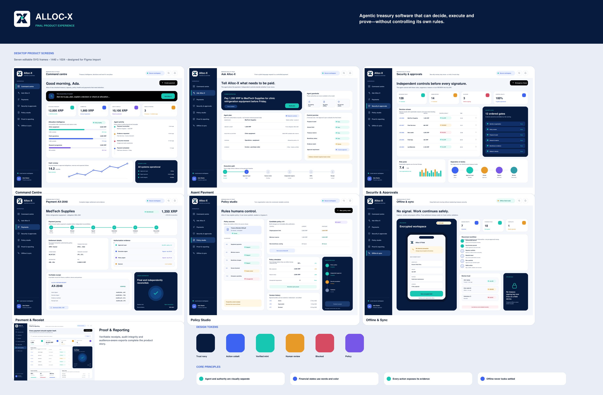

# Alloc-X documentation

This directory contains the public product and technical materials for Alloc-X.
They describe the intended product direction and target architecture; they are not claims that every capability is already deployed.

| Document | What it covers |
| --- | --- |
| [Project concept](./project-concept.pdf) | The institutional payment problem, African target users, core capabilities, XRPL fit, impact and business direction. |
| [Technical foundation](./technical-foundation.pdf) | Proposed technology stack, infrastructure boundaries, environment design and development approach. |
| [Architecture diagram](./architecture-diagram.pdf) | The end-to-end path from payment instruction through the Approval Layer, Security Layer, signing, XRPL settlement and reconciliation. |
| [Final product mockup](./final-product-mockup.pdf) | A visual walkthrough of the intended Alloc-X product experience. |
| [Figma overview board](./figma-overview-board.png) | A high-level visual overview of the product surfaces and their relationship. |
| [Clickable mockup](./clickable-mockup.html) | An interactive local walkthrough of the key product screens. |
| [Team status update](./team-status-update.pdf) | Builder profile, delivery priorities, workstream ownership and execution stages. |

## Product in one sentence

Alloc-X helps organizations turn a payment instruction into a controlled, agent-executed and independently verifiable XRPL payment—without weakening financial safeguards.

## Public-materials policy

This repository intentionally excludes credentials, signing keys, confidential beneficiary data, private invoices, internal evidence and editable working files.
