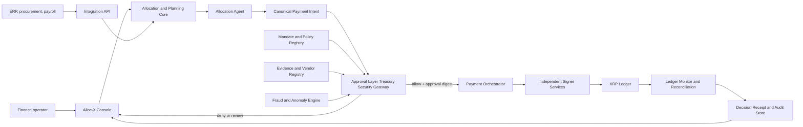
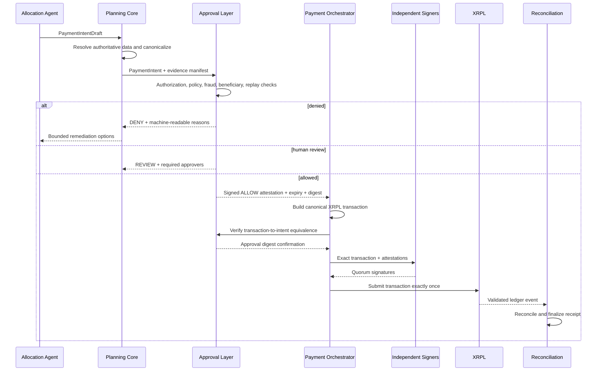

# Alloc-X Production Architecture

## 1. Purpose

Alloc-X converts organizational rules, budgets, invoices, and operational priorities into safe treasury actions. It is designed to answer four questions before executing a payment:

1. **Authority:** who or what is allowed to request this payment?
2. **Eligibility:** which policy, allocation, and evidence permit it?
3. **Safety:** has the request been manipulated, duplicated, redirected, or made anomalous?
4. **Settlement:** did the approved transaction, and only that transaction, become validated on XRPL?

The system separates autonomous decision-making from payment authority. The agent creates typed intents and explanations. Deterministic services control authorization, transaction construction, signing, submission, and reconciliation.

## 2. System invariants

These rules apply regardless of interface, model, organization type, or payment size:

1. The AI runtime never receives ledger private keys or signing credentials.
2. Natural-language output is never accepted as an executable payment.
3. Every payment starts as a schema-validated `PaymentIntent` with an idempotency key.
4. A published policy version is immutable; changes create a new version.
5. The agent cannot publish policy, change its own limits, approve a new beneficiary, or disable audit controls.
6. Approval Layer fails closed when a required check is unavailable, stale, or inconclusive.
7. The transaction signed must be byte-for-byte equivalent to the transaction that Approval Layer approved.
8. A beneficiary wallet change is a security event, not an ordinary profile update.
9. Duplicate or replayed intents cannot cause a second payment.
10. A payment is complete only after ledger validation and internal reconciliation.
11. Every decision is attributable to a principal, policy version, evidence set, and software version.
12. Offline work can prepare an intent but cannot bypass online revalidation before signing.

## 3. Context diagram



## 4. Component boundaries

### 4.1 Operator console

Provides treasury status, obligations, proposed payments, veto explanations, policy management, beneficiary changes, approvals, incident controls, and receipts. High-risk actions require step-up authentication and cannot be approved by the same principal that initiated them.

### 4.2 Identity and organization service

Manages organizations, business units, roles, service identities, segregation of duties, session risk, and organization-specific approval matrices. Authorization is evaluated server-side for every state change.

### 4.3 Mandate Compiler and policy registry

Transforms approved organizational rules into a deterministic policy bundle. Source documents may be parsed with AI, but an authorized human must review and publish the structured result. A bundle contains:

- eligible purposes and prohibited categories;
- budget ceilings, time windows, and reserve floors;
- permitted assets, networks, and destination classes;
- evidence requirements;
- approval thresholds and signer quorum;
- vendor and beneficiary rules;
- velocity, concentration, and exception limits; and
- effective dates plus revocation status.

Policies are versioned, signed, immutable after publication, and evaluated by a deterministic policy engine.

### 4.4 Allocation and planning core

Maintains obligations, treasury balances, allocation envelopes, due dates, forecasts, and payment schedules. It supplies the agent with bounded tools rather than direct database or ledger access.

### 4.5 Allocation agent

The agent can classify obligations, select eligible allocations, recommend timing, request missing evidence, and propose safe alternatives after a veto. Its only payment-side output is a typed `PaymentIntentDraft`. Server-side code resolves authoritative identifiers and creates the final intent.

### 4.6 Evidence and vendor registry

Stores invoice hashes, purchase orders, delivery evidence, beneficiary identities, approved wallet addresses, bank or mobile-money mappings, risk status, and change history. Raw documents are treated as untrusted content and are never allowed to issue agent instructions.

### 4.7 Approval Layer Treasury Security Gateway

An independently deployed pre-settlement boundary. It verifies authority, policy, evidence, fraud signals, transaction semantics, and approval state. It returns one of three signed outcomes:

- `ALLOW`: may proceed only for the approved digest and before expiry;
- `REVIEW`: requires a named human approval route and cannot auto-settle; or
- `DENY`: cannot proceed; a new intent is required after remediation.

Detailed controls are defined in [SECURITY_ARCHITECTURE.md](./SECURITY_ARCHITECTURE.md).

### 4.8 Payment orchestrator

Converts an allowed intent into a canonical XRPL transaction, obtains current ledger conditions, enforces fee ceilings and expiry, collects signatures, submits exactly once, and tracks finality. It cannot relax Approval Layer decisions.

Its local implementation is a fsynced hash-linked job journal with short worker
leases and bounded retry attempts. The journal records a deterministic signed
transaction hash before any submission attempt. On redelivery, the orchestrator
first looks up that hash; if it must retry, it can only submit the same signed
blob, never rebuild or re-sign a different payment. Deployment replaces the
local journal with a transactional durable queue or workflow store while keeping
this state machine and its signer boundary unchanged.

### 4.9 Independent signer services

Signing keys are held in separate KMS or HSM trust domains. The initial design uses an XRPL signer list with weighted quorum:

- execution signer: confirms the canonical transaction and active job lease;
- Approval Layer policy signer: signs only a live `ALLOW` digest that matches the transaction; and
- recovery signer: controlled by designated treasury officers for rotation and recovery.

Normal autonomous execution requires the execution and policy signers. A single compromised runtime cannot spend independently. Production key ceremonies, quorum weights, key rotation, and recovery procedures must be completed before main-network activation.

The implemented signer boundary accepts one immutable signing envelope containing the
intent digest, Approval Layer decision digest, target network, transaction digest, and
expiry. Each signer independently recomputes the transaction digest before using
its key provider. The assembler requires both normal roles as well as the XRPL
quorum; recovery remains a separately held identity for an observed recovery or
rotation procedure. Key-provider interfaces can sign only and cannot submit a
ledger transaction.

### 4.10 Ledger adapter

Owns XRPL-specific serialization, account state reads, fee checks, sequence or ticket management, multi-sign assembly, submission, validation tracking, and error normalization. It supports XRP first and issued assets through explicit allowlists.

### 4.11 Decision receipt and audit store

Creates an append-only receipt containing:

- decision and intent identifiers;
- initiator and autonomous actor identity;
- selected allocation and budget before/after;
- rationale and cited policy clauses;
- evidence hashes and beneficiary version;
- all Approval Layer checks and outcomes;
- approval and signer attestations;
- canonical transaction digest;
- XRPL transaction hash, ledger index, and validation result; and
- timestamps, model version, policy version, and application release.

The receipt hash is anchored in the transaction `InvoiceID` or memo field where appropriate, while full evidence remains encrypted off-ledger.

### 4.12 Ledger monitor and reconciliation

Independently watches treasury accounts, matches validated transactions to expected settlement records, finalizes the corresponding accounting reservation, raises alerts for unknown or mismatched transactions, and detects submission or accounting divergence. It has a separate read-only XRPL adapter that verifies the expected network and ingests only validated, successful native-XRP payments. The monitor cannot construct, sign, or submit a transaction.

The local monitor journal is fsynced and hash chained. It records expected settlements, cursors, observed hashes, reconciliations, and alerts, then verifies integrity before restoring state or advancing a cursor. A failed accounting finalization leaves the transaction unobserved so that a retry can safely invoke accounting's idempotent settlement operation. Deployed monitoring runs with an independent read-only service identity and a transactional durable-store adapter.

### 4.13 Autonomous payment path

The autonomous payment path is the server-owned composition boundary across intent reservation, Approval Layer evaluation, beneficiary resolution, payment orchestration, and independent reconciliation. It accepts no browser-supplied economic field or destination. An `ALLOW` must be signed for the exact intent digest; then the destination is resolved from the beneficiary authority and its wallet version must equal the version embedded in the intent. The path reports `VALIDATED` only after the settlement worker has observed XRPL validation and `RECONCILED` only after the independent monitor has finalized accounting for that same transaction hash.

## 5. Payment lifecycle



### State machine

`DRAFT -> READY -> EVALUATING -> DENIED | REVIEW_REQUIRED | ALLOWED -> SIGNING -> SUBMITTED -> VALIDATED -> RECONCILED`

Terminal exception states are `EXPIRED`, `CANCELLED`, and `FAILED`. No transition may skip `EVALUATING`, and any mutation to amount, asset, destination, evidence, allocation, or policy version creates a new digest and returns the intent to `READY`.

## 6. Core data contracts

### PaymentIntent

```json
{
  "intentId": "pi_...",
  "organizationId": "org_...",
  "idempotencyKey": "org/source/obligation/version",
  "sourceObligationId": "obl_...",
  "allocationId": "alloc_...",
  "amount": "1250.00",
  "asset": "XRP_OR_ALLOWLISTED_ISSUED_ASSET",
  "beneficiaryId": "ben_...",
  "beneficiaryWalletVersion": 3,
  "purposeCode": "approved-purpose",
  "evidenceManifestHash": "sha256:...",
  "policyVersion": "policy_...",
  "requestedExecutionWindow": {
    "notBefore": "RFC3339 timestamp",
    "expiresAt": "RFC3339 timestamp"
  },
  "createdBy": {
    "principalId": "principal_...",
    "actorType": "human-or-agent"
  }
}
```

Amounts use fixed-precision decimal types and are converted to ledger units only in the ledger adapter. Wallet addresses and asset identifiers are resolved from versioned registries, never copied from an invoice or chat message.

### SecurityDecision

```json
{
  "decisionId": "sec_...",
  "intentId": "pi_...",
  "intentDigest": "sha256:...",
  "outcome": "ALLOW_OR_REVIEW_OR_DENY",
  "reasonCodes": ["POLICY_CHECK_CODE"],
  "requiredApprovals": [],
  "riskScore": 0,
  "policyVersion": "policy_...",
  "evaluatedAt": "RFC3339 timestamp",
  "expiresAt": "RFC3339 timestamp",
  "approvalLayerSignature": "detached-signature"
}
```

## 7. Data and infrastructure

### Primary stores

- relational database: organizations, identities, policies, obligations, allocations, intents, decisions, approvals, and reconciliation state;
- encrypted object store: source documents and generated receipts;
- append-only audit stream: security-relevant events with hash chaining;
- queue: durable, idempotent payment, monitoring, and receipt jobs; and
- analytics store: de-identified risk features and operational metrics.

### Service topology

The first production deployment may use a modular monolith for the console, API, planning core, and registries. Approval Layer, signer services, and the ledger monitor remain separately deployable security domains with distinct identities, credentials, databases where required, and network policies. This preserves a real security boundary without premature operational fragmentation.

### Suggested repository layout

```text
apps/
  console/
  api/
services/
  approval-layer/
  payment-worker/
  ledger-monitor/
packages/
  contracts/
  policy-engine/
  xrpl-adapter/
  evidence/
  observability/
infra/
  environments/
  policies/
tests/
  integration/
  security/
  ledger/
```

## 8. Offline operation

Offline support is deliberately introduced after the online settlement path is stable. The local client may read an encrypted snapshot, capture obligations and evidence, draft allocations, and collect local attestations. It stores operations in a signed, append-only journal.

When connectivity returns:

1. the server authenticates the device and operator again;
2. operations synchronize with conflict detection;
3. authoritative balances, beneficiary versions, policies, risk signals, fees, and ledger state are refreshed;
4. every payment intent is reconstructed and evaluated by Approval Layer; and
5. only a fresh online `ALLOW` outcome can enter signing.

No private treasury signing key is stored on the offline client. A payment displayed as prepared offline is never represented as settled.

## 9. Expansion model

The final delivery stage generalizes organization behavior through configuration rather than forks:

- organization-type policy packs;
- configurable chart of accounts and approval matrices;
- procurement and payroll adapters;
- jurisdiction-aware evidence and retention rules;
- public-sector appropriation, warrant, and expenditure-control workflows; and
- tenant-specific reporting and sovereignty controls.

The payment intent, security decision, signing, settlement, and receipt contracts remain stable across organization types.

## 10. Reliability and observability targets

- All write APIs require idempotency keys and return stable operation identifiers.
- Payment jobs use durable queues, leases, bounded retries, and dead-letter handling.
- Security decisions and approvals have short expiries and cannot be replayed.
- The ledger monitor operates independently of the submission worker.
- Alerts cover unknown outflows, signer failures, reconciliation drift, policy evaluation failure, beneficiary changes, and elevated veto rates.
- Logs never contain private keys, full documents, authentication secrets, or unnecessary personal data.
- Recovery objectives, backup restoration, and key-recovery drills are tested before production activation.

## 11. Delivery stages

1. **Foundation and security invariants** — contracts, identity, policy kernel, audit chain, environment separation.
2. **Controlled XRPL settlement** — canonical intents, Approval Layer, independent signing, real validated payment, reconciliation.
3. **Mandate Compiler** — reviewed policy extraction, versioning, simulation, publication.
4. **Decision receipts and evidence** — evidence binding, ledger anchoring, exportable proof.
5. **Fraud and vendor integrity** — duplicate detection, wallet-change protection, document and behavioral risk.
6. **Autonomous allocation and cash planning** — forecasts, schedules, allocation selection, safe replanning.
7. **Operational hardening** — production security, resilience, observability, recovery, and release gates.
8. **Offline operation** — encrypted local journal, secure synchronization, mandatory online revalidation.
9. **Organization expansion** — reusable commercial, nonprofit, and public-sector policy packs.
